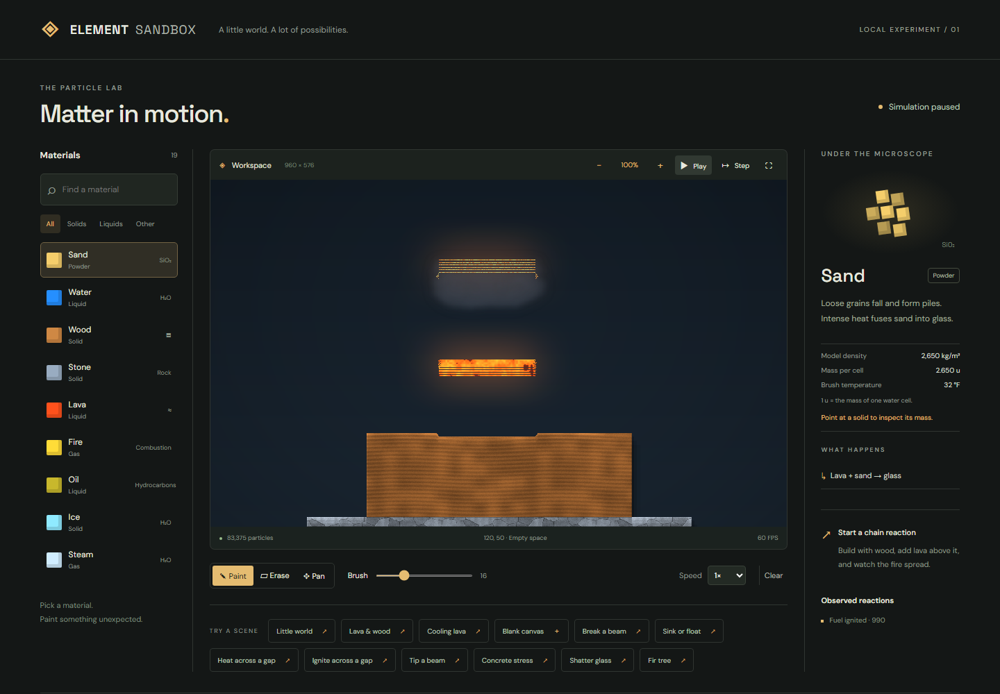
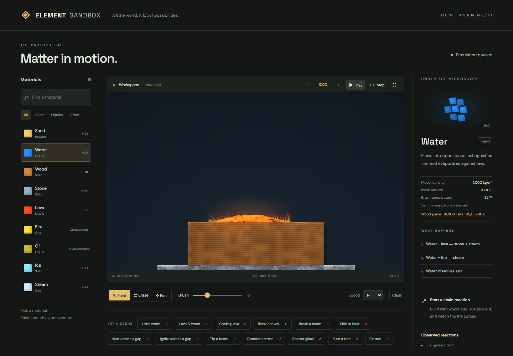
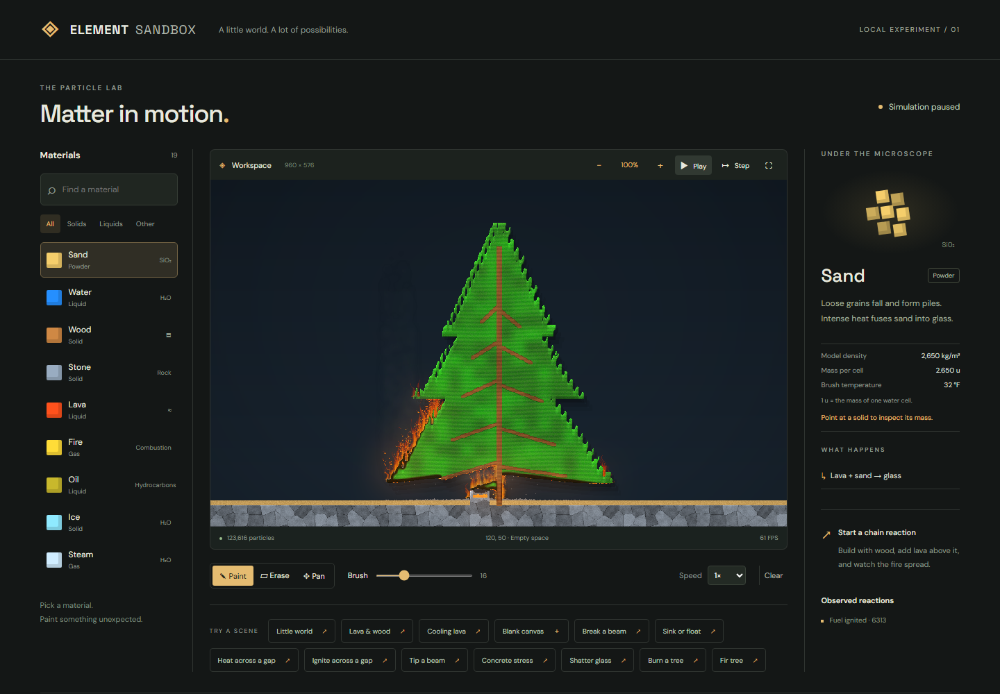
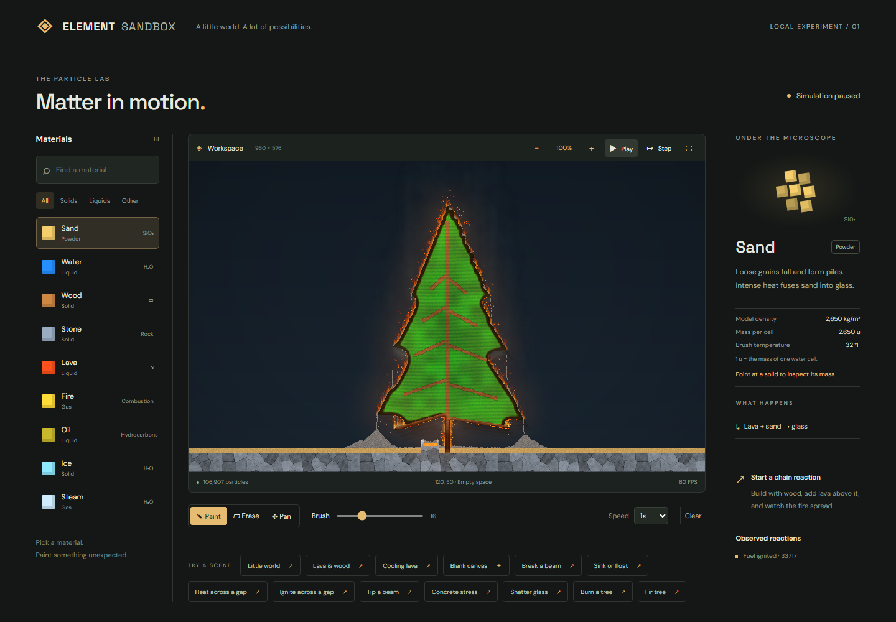
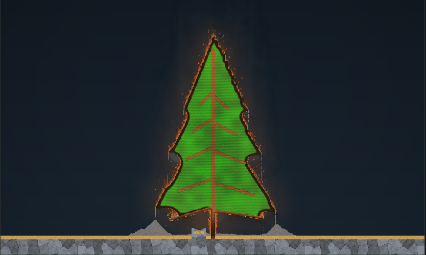

# Progressive combustion

The previous lab reaction changed any wood, grass or oil touching fire/lava directly into a moving fire particle. Every new particle could immediately convert another neighbor. Its 160–359 tick lifetime then produced ash regardless of whether it had consumed fuel. This combined fast chain propagation, loss of connected solids, synchronized upward motion and an oversized bright cloud.

## Fuel and ignition

`MaterialDefinition.combustion` replaces that path for the lab's three fuels. The reusable engine retains the old optional replacement rules for existing consumers and compatibility fixtures; a material cannot opt into both models.

Each fuel cell carries remaining fuel and burning intensity. Particle temperature must remain above `ignitionPoint` for `exposureTicks` consecutive 60 Hz steps. Cooling below the threshold resets that exposure. Once lit, the cell keeps its material ID, texture coordinates and connected membership. Temperature below `extinctionPoint`, or adjacent configured extinguishers, stops combustion without restoring consumed fuel. Reignition requires the full exposure again.

Fuel consumption and emissions run every third tick (20 Hz). Consumption is `burnRate × 3 × intensity`, capped by available fuel. Intensity depends on exposed faces, temperature relative to `flameTemperature`, and remaining fuel. The final 15% tapers into smouldering; below 0.5% the cell exhausts. Enclosed fuel can smoulder at a reduced rate, but cannot emit gas without a vacant neighboring cell. This is a surface-area approximation, not an oxygen simulation.

Consumed fuel releases `heatRelease / heatCapacity` heat per fuel unit, capped at `flameTemperature`. Burning cells seed the existing coarse thermal field. Heat conduction, air exchange, ice melting and lava cooling continue through their existing paths. Lava no longer deletes fuel on contact. Water/saltwater immediately quench neighboring burning fuel and lower its temperature; their existing gas-extinguishing reactions still apply.

| Parameter | Wood | Grass | Oil |
| --- | ---: | ---: | ---: |
| Ignition point, model degrees | 343.5 | 287.8 | 250 |
| Exposure, ticks | 90 | 24 | 18 |
| Extinction point | 180 | 140 | 120 |
| Fuel load | 1 | 0.18 | 0.7 |
| Burn rate, fuel/tick before intensity | 0.00065 | 0.0018 | 0.0035 |
| Heat release | 42,000 | 30,000 | 32,000 |
| Flame temperature | 880 | 760 | 1,050 |
| Flame chance per emission update, scaled by intensity | 0.55 | 0.38 | 0.8 |
| Smoke chance per emission update, adjusted for burn state | 0.10 | 0.07 | 0.22 |
| Residue / probability | ash / 0.40 | ash / 0.15 | empty / 0 |
| Remaining mass fraction | 0.30 | 0.20 | 0.15 |

There is no universal material burn timer. Exposure, fuel, heat, geometry and cooling determine duration. Flame gas has its own 28–55 tick lifetime and expires into empty space. Only consumed fuel can leave ash. Residue probability avoids turning an entire grass crown into an equally large ash pile. Emissions use the simulation's seeded random sequence.

## Structure and transport

`fuel`, `burning` and gas `emissionSource` travel through particle swaps and rigid-body rotation together with temperature, exposure and UVs. Placement and clearing reset them. Connected-body mass falls linearly with fuel toward `remainingMass`; only actual consumption triggers mass recalculation. Existing support, gravity, buoyancy and collision code uses that changing mass. Consuming a connecting cell updates the existing topology cache, releasing unsupported branches. Wood does not turn into loose fire when first ignited.

This is progressive erosion of load-bearing sections, not a new elastic wood-fracture solver. Within a surviving rigid piece, the existing geometric centre/inertia approximation remains. Ash conversion and emitted gas are qualitative fixed-volume cells, not a mass-conserving chemistry model.

## Flame rendering

The existing procedural renderer darkens wood/grass as fuel is consumed and adds uneven ember glow. A bounded set of flame anchors (one per 4×4 region) produces tapered, swaying tongues with phase-offset brightness, changing height, intermittent split tips and occasional rising sparks. Height follows burn intensity and fuel type. Color combines temperature, position within the tongue, cooler edges, fuel-specific offsets and occasional bright cores. Short-lived gas particles drift upward with seeded pauses and diagonal movement instead of rising in synchronized rows.

Rendering uses coordinate hashes and an explicit visual time, never the simulation RNG. The worker supplies wall-clock visual time while playing and fixed simulation time while paused. Light emission varies with burning intensity and flicker. Gas retains its source fuel for smoke coloring: oil is darker/denser, grass lighter, wood brown-gray. Smoke lifetime fades its opacity in the existing blurred vapor pass.

The flame budget is collected during the existing pixel pass; no additional full-grid flame scan or per-flame object allocations are needed. New particle state uses approximately 4.75 MiB at 960×576, plus about 0.17 MiB for renderer anchor buffers. Thermal and connected-solid passes remain the main costs in active dense scenes.

## Repeatable demonstration and checks

Select **Burn a tree** at 1×. The normal 960×576 fir starts above a small contained lava ember bed. Watch the lower surfaces ignite, char, emit smoke and gradually spread upward. **Fir tree** is the unlit control. The existing **Ignite across a gap** source basins now have connected stone walls on both sides: its previously open right-hand pool could flow left into the grass as the scene evolved, invalidating its non-contact demonstration.

- `npm run verify`: all deterministic tests, TypeScript and production build.
- `npx tsx scripts/benchmark-combustion.ts [baseline-root]`: same-machine 960×576 comparison, 600 warmup ticks and 180 measured ticks; rendering sampled every third tick. The optional baseline is a checkout/archive of the old source.
- `node scripts/capture-combustion.cjs`: real Chromium UI, screenshots/video at 10/30/60 seconds and control checks. Requires an available Playwright installation; `PLAYWRIGHT_MODULE` can point to it. `COMBUSTION_URL` selects the local server and `COMBUSTION_EVIDENCE_DIR` the output directory. Use a production preview to avoid hot reload interrupting a long capture.

Coverage includes ignition thresholds/delay/reset, gradual fuel loss, differing burn times, propagation, water/saltwater quenching and reignition, smoke/residue, branch detachment, transported state, deterministic replay, render isolation/colors/charring, native-resolution retention and a relative cold-scene performance guard. The original compatibility snapshots remain unchanged and use the captured legacy material configuration.

## Measured performance and limits

Local Node 24 measurements on October 25, 2026, comparing main `7d3d902` with this implementation (milliseconds; CPU render excludes the browser's vapor blur/compositing):

| 960×576 scene | Old step mean / p95 | New step mean / p95 | Old render mean | New render mean |
| --- | ---: | ---: | ---: | ---: |
| Unlit fir | 5.26 / 5.65 | 6.03 / 6.64 | 6.45 | 8.98 |
| Localized tree burn | 59.63 / 73.98 | 16.46 / 40.99 | 7.89 | 8.81 |
| Lava & wood | 53.30 / 74.29 | 8.36 / 18.65 | 7.91 | 7.62 |

At tick 780 the old localized burn retained 13 of 8,451 wood cells; this implementation retained all 8,451. The new cold-scene bookkeeping has a modest cost; burning scenes avoid the old explosion in fire/smoke particles. These are scene/device-specific samples, not a guaranteed 60 simulation updates per second. Dense thermal/topology updates still exceed a 16.7 ms budget, and the existing display FPS counter does not measure simulation throughput.

Remaining limits: authored game units, isotropic coarse heat without radiation occlusion, no oxygen/pressure/moisture reservoirs, approximate rigid-body mass distribution, cosmetic rather than colliding sparks, and no low-end/mobile hardware performance certification. The pre-existing Phaser bundle-size warning remains outside this change.
## Verification results and visual evidence

On October 25, `npm run verify` passed **115 tests**, TypeScript checking and the production build. The native tree regression retained all 8,451 wood cells at tick 600. The relative cold-tree guard measured 5.84 ms/update for legacy configuration and 6.64 ms for progressive combustion during the shared test run. Timing varies with other work on the host.

Chromium desktop (1440×1000) and emulated mobile (390×844) checks passed pause, single-step, zoom/reset, water painting, clear, scene reset and expanded/fullscreen layout with no page/console errors. The controls capture explicitly waits for worker inspection acknowledgements; fixed sleeps alone can observe stale display statistics. No physical mobile device was used.

Before/after screenshots illustrate the old detached, striped fire cloud versus surface-associated tongues with retained wood. They are not matched-tick performance samples; use the benchmark for exact-tick comparisons. Tree images are approximately 30 and 60 simulated seconds, with exact runtime time affected by the live worker continuing between commands. The GIF shows ordinary live frames without manually advancing the simulation.

| Before | After |
| --- | --- |
|  |  |

